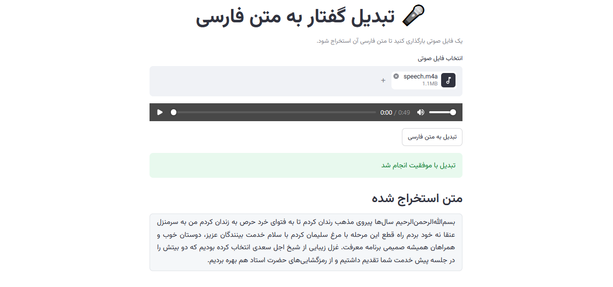
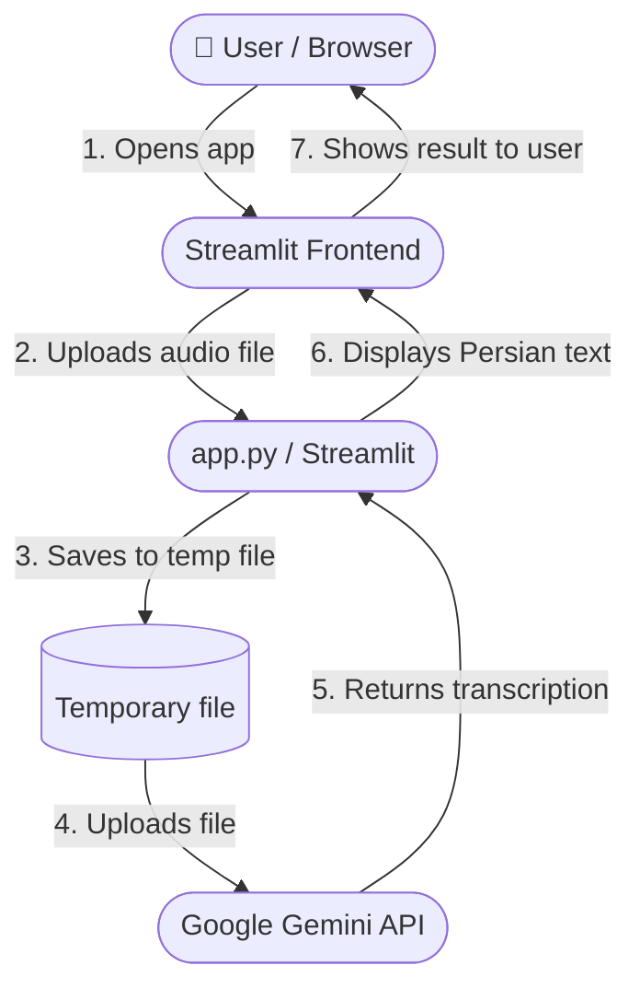

# Persian Speech-to-Text App

A lightweight, web-based **Speech-to-Text (STT)** application that transcribes Persian (Farsi) audio files into text.  
It is built with **Streamlit** for the frontend and powered by **Google Gemini's transcription model** via the `google-genai` SDK. The interface is fully right-to-left (RTL) and styled with a Persian web font (Vazirmatn) for a native Persian reading experience.

Simply upload an audio file (MP3, WAV, M4A, OGG, or FLAC), click the convert button, and read the extracted Persian text directly in the browser.

---

## 🖼️ Demo



---

## 🏗️ Overall System Architecture

The application follows a simple **client → backend → AI model** flow. Below is a high-level view of how the pieces fit together:



### How the project works (based on the architecture)

1. **Frontend (Streamlit UI)**  
   `app.py` renders a centered, RTL Persian page. The user chooses an audio file through `st.file_uploader`, previews it with `st.audio`, and clicks **"تبدیل به متن فارسی"** (Convert to Persian text).

2. **Audio handling (app.py)**  
   When the button is pressed, the uploaded audio is written to a temporary file on disk and uploaded to Gemini with an explicit MIME type selected from its file extension.

3. **AI transcription (Google Gemini)**  
   The app initializes `genai.Client()` (which reads `GOOGLE_API_KEY` from `.env`), uploads the temporary audio file via `client.files.upload(...)`, and calls `client.models.generate_content(...)` using the Gemini transcription model with the prompt `"Transcribe this audio to persian text"`.

4. **Result extraction**  
   The response is parsed for `audio_transcription` parts. If found, the Persian transcription is shown inside a styled RTL box; otherwise an error message is displayed.

5. **Cleanup**  
   The temporary file is deleted in a `finally` block, keeping the workspace clean.

## 📁 Project Structure

```text
speech-to-text/
├── app.py                   # Main Streamlit application (UI + transcription logic)
├── requirements.txt         # Python dependencies
├── .env                     # Environment variables (GOOGLE_API_KEY)
├── imgs/
│   └── speech-to-text.PNG   # Demo screenshot for the README
├── data/                    # Data directory
└── مستندات و گزارش پروژه/  # Project documentation & reports
```

## 🛠️ Technology Stack

| Layer                       | Technology                                                          | Purpose                                         |
| --------------------------- | ------------------------------------------------------------------- | ----------------------------------------------- |
| **Frontend / App**          | [Streamlit](https://streamlit.io) (1.65.0)                          | Web UI, file uploader, audio player, RTL layout |
| **AI / Transcription**      | [Google Gemini](https://ai.google.dev/) via `google-genai` (2.33.0) | Speech-to-text transcription model              |
| **Environment**             | `python-dotenv` (1.2.4)                                             | Loads `GOOGLE_API_KEY` from `.env`              |
| **Language**                | Python (≥ 3.12)                                                     | Application runtime                             |
| **Styling**                 | Custom CSS + Google Fonts (Vazirmatn)                               | RTL Persian UI and typography                   |
| **Supported audio formats** | MP3, WAV, M4A, OGG, FLAC                                            | Input file types                                |

## 🚀 How to Run the Project

### 1. Create a virtual environment

```powershell
py -3.12 -m venv .myenv
```

### 2. Activate the virtual environment

**PowerShell:**

```powershell
.myenv\Scripts\Activate.ps1
```

**Command Prompt (cmd):**

```cmd
.myenv\Scripts\activate.bat
```

### 3. Install dependencies

```powershell
pip install -r requirements.txt
```

### 4. Configure environment variables

Create a `.env` file in the project root and add your Google Gemini API key:

```env
GOOGLE_API_KEY=YOUR_GOOGLE_GEMINI_API_KEY_HERE
```

### 5. Run the application

```powershell
streamlit run app.py
```

### 6. Open the app in your browser

Navigate to:

```
http://localhost:8501/
```

### 7. Upload audio and obtain transcription

1. Click Upload and select an audio file (`mp3`, `wav`, `m4a`, `ogg`, or `flac`).
2. Preview the audio using the built-in player.
3. Click **تبدیل به متن فارسی** (Convert to Persian text).
4. Wait for the spinner ("...در حال بارگذاری و تبدیل") to finish.
5. Read the extracted Persian transcription in the result box.

## 🐳 Running with Docker

Docker is the recommended way to run this app — it packages Python, Streamlit, and all dependencies into a single image so you don't need to manage virtual environments locally.

### Prerequisites

- [Docker](https://docs.docker.com/get-docker/) (Docker Compose is included)

### 1. Configure your environment

Copy the example environment file and add your Google Gemini API key:

```powershell
copy .env.example .env
```

Then open `.env` and replace `YOUR_GOOGLE_GEMINI_API_KEY_HERE` with your actual key from [Google AI Studio](https://aistudio.google.com/app/apikey).

### 2. Build and run

Using Docker Compose (recommended):

```powershell
docker compose up --build
```

Or with plain Docker:

```powershell
docker build -t speech-to-text .
docker run -p 8501:8501 --env-file .env speech-to-text
```

### 3. Open the app

Navigate to:

```
http://localhost:8501/
```

### 4. Stop the app

```powershell
docker compose down
# or, for plain Docker:
docker stop speech-to-text
```

### Docker commands

| Command                     | Purpose                             |
| --------------------------- | ----------------------------------- |
| `docker compose up --build` | Build image and start container     |
| `docker compose up -d`      | Start in detached (background) mode |
| `docker compose logs -f`    | Follow container logs               |
| `docker compose down`       | Stop and remove container           |
| `docker compose ps`         | Show running container status       |

---

## ⚡ Performance Notes

- **Transcription latency** depends on the audio duration and Google Gemini API response time; longer files take longer to process.
- Audio is streamed to Gemini via a temporary file, so very large files may increase upload time and memory usage briefly.
- The first run may take a few seconds extra as Streamlit compiles the frontend and the model initializes.
- The interface uses an external Google Font (Vazirmatn); if the font fails to load, it falls back to Tahoma/Arial while keeping the RTL layout intact.
- For best transcription quality, use clear audio with minimal background noise.

## 🔧 Troubleshooting

| Issue                                              | Possible Cause                                         | Solution                                                                                         |
| -------------------------------------------------- | ------------------------------------------------------ | ------------------------------------------------------------------------------------------------ |
| `ModuleNotFoundError: No module named 'streamlit'` | Dependencies not installed                             | Run `pip install -r requirements.txt` inside the activated venv                                  |
| `GOOGLE_API_KEY` error / authentication failure    | Missing or invalid API key in `.env`                   | Add a valid key to `.env` as `GOOGLE_API_KEY=...` and restart the app                            |
| `streamlit` is not recognized                      | Streamlit not installed or venv not activated          | Activate `.myenv` first, then install requirements                                               |
| Port 8501 already in use                           | Another Streamlit app is running                       | Close the other app, or run on a different port: `streamlit run app.py --server.port 8502`       |
| Transcription returns empty or error               | API quota exceeded, network issue, or unsupported file | Check your internet connection, API quota, and that the file is one of: mp3, wav, m4a, ogg, flac |
| Persian text appears broken / left-aligned         | RTL CSS not applied                                    | Ensure you are using a modern browser; the app injects RTL styles automatically                  |

### Quick reset

If something goes wrong, you can recreate the environment from scratch:

```powershell
Remove-Item -Recurse -Force .myenv
py -3.12 -m venv .myenv
.myenv\Scripts\activate.bat
pip install -r requirements.txt
streamlit run app.py
```
